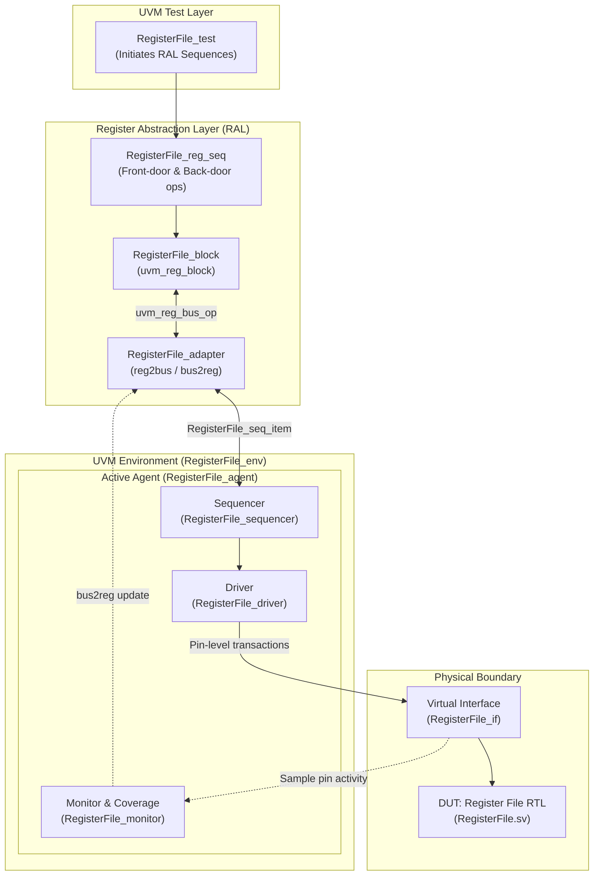

# Universal Verification Methodology (UVM) RAL Verification of Register File

[](https://en.wikipedia.org/wiki/SystemVerilog)
[](https://www.accellera.org/downloads/standards/uvm)
[](https://eda.sw.siemens.com/)
[](sim/reports/code_coverage_DUT.txt)
[](sim/reports/coverage_report_summary.txt)
[](sim/reports/functional_coverage.txt)

A complete, production-grade **UVM 1.2 Verification Environment** demonstrating the **UVM Register Abstraction Layer (RAL)** on a multi-register memory-mapped peripheral.

Developed by **[Moonis Amir Zaman](https://github.com/MoonisAmir10)** (M.Sc. Microelectronics & Chip Design, Technical University of Munich).

---

## 📌 Project Highlights

* **Architecture-Level Register Abstraction**: Implements an enterprise UVM RAL model (`uvm_reg_block`, `uvm_reg`, and `uvm_reg_adapter`) enabling both high-level abstraction and low-level protocol compatibility.
* **Front-Door & Back-Door Access**: Full verification of bus-driven transactions (`uvm_reg::write/read`) alongside zero-cycle direct backdoor introspection (`uvm_reg::peek/poke`).
* **Constrained-Random Verification**: Systematic randomized stress testing exercising corner-case bit patterns (`0x00000000`, `0xFFFFFFFF`, `0xAAAAAAAA`, `0x55555555`, walking ones/zeros).
* **High Metric Closure**:
  * **100%** Statement Coverage
  * **98.58%** Toggle Coverage
  * **88.88%** Branch Coverage
  * **100%** Functional Covergroup Coverage

---

## 🏛️ Verification Architecture

The testbench follows the standard UVM layered architecture, cleanly decoupling stimulus generation, protocol translation, and physical pin driving:



---

## 📋 Register Map Specification

The design under test (DUT) implements a 32-bit synchronous memory-mapped register file:

| Register Name | Address Offset | Width | Type | Description |
|:---|:---:|:---:|:---:|:---|
| **RXTX0** | `0x0000_0000` | 32-bit | RW | Transmit/Receive Buffer Register 0 |
| **RXTX1** | `0x0000_0004` | 32-bit | RW | Transmit/Receive Buffer Register 1 |
| **RXTX2** | `0x0000_0008` | 32-bit | RW | Transmit/Receive Buffer Register 2 |
| **RXTX3** | `0x0000_000C` | 32-bit | RW | Transmit/Receive Buffer Register 3 |
| **CTRL** | `0x0000_0010` | 32-bit | RW | Peripheral Control Register |
| **DIVIDER** | `0x0000_0014` | 32-bit | RW | Baud Rate / Clock Prescaler Register |
| **SS** | `0x0000_0018` | 32-bit | RW | Slave Select / Chip Select Register |

---

## 📊 Verification Metrics & Coverage Summary

Results extracted from ModelSim / QuestaSim Unified Coverage Database (`RegisterFile_coverage.ucdb`):

| Coverage Type | Bins Hit | Total Bins | Coverage Percentage | Verification Status |
|:---|:---:|:---:|:---:|:---:|
| **Statement Coverage** | 18 | 18 | **100.00%** | ✅ Fully Covered |
| **Toggle Coverage** | 139 | 141 | **98.58%** | ✅ Clean Closure |
| **Branch Coverage** | 16 | 18 | **88.88%** | ✅ All Valid Branches Hit |
| **Functional Covergroups** | - | - | **100.00%** | ✅ All Address/Data Bins Hit |

*Detailed reports are archived in [sim/reports/](sim/reports/).*

---

## 📂 Repository Structure

```
uvm-register-file-verification/
├── rtl/
│   └── RegisterFile.sv            # Synthesizable RTL description of Register File
├── tb/
│   ├── include/
│   │   └── shared_pkg.sv          # Global parameters, types, and addresses
│   ├── ral/
│   │   ├── Registers.sv           # Individual uvm_reg field definitions
│   │   ├── RegisterFile_block.sv  # Top-level uvm_reg_block structure
│   │   └── RegisterFile_adapter.sv# Bus-to-RAL protocol translation
│   ├── agents/
│   │   ├── RegisterFile_seq_item.sv # Transaction sequence item
│   │   ├── RegisterFile_driver.sv   # Pin-level bus driver
│   │   ├── RegisterFile_monitor.sv  # Bus monitor & coverage collector
│   │   ├── RegisterFile_sequencer.sv# UVM transaction sequencer
│   │   ├── RegisterFile_config.sv   # Agent configuration object
│   │   └── RegisterFile_agent.sv    # UVM Agent encapsulating components
│   ├── sequences/
│   │   ├── RegisterFile_write_sequence.sv # Direct write sequence
│   │   └── RegisterFile_reg_seq.sv        # Comprehensive RAL test sequences
│   ├── env/
│   │   ├── RegisterFile_if.sv     # SystemVerilog interface
│   │   ├── RegisterFile_env.sv    # Top-level UVM verification environment
│   │   └── RegisterFile_test.sv   # Base and randomized test cases
│   └── top/
│       └── RegisterFile_top.sv    # Top testbench module with clock generation
├── sim/
│   ├── Makefile                   # Automated build & simulation runner
│   ├── src_files.list             # Ordered compilation list
│   ├── run_RegisterFile.do        # QuestaSim macro script
│   └── reports/                   # Coverage logs and text metrics
└── docs/
    ├── verification_plan.md       # Comprehensive verification specification
    └── *.pdf                      # Academic verification reports and presentation
```

---

## 🚀 Quick Start: How to Run

### Prerequisites
* Mentor / Siemens **QuestaSim** or **ModelSim** (with UVM 1.2 support)
* Linux Shell (`bash`) and GNU `make`

### Running the Simulation
1. Clone this repository:
   ```bash
   git clone https://github.com/MoonisAmir10/uvm-register-file-verification.git
   cd uvm-register-file-verification/sim
   ```

2. Run in batch mode (compilation, simulation, and report generation):
   ```bash
   make sim
   ```

3. Run in interactive GUI mode with waveforms:
   ```bash
   make sim_gui
   ```

4. Clean simulation artifacts:
   ```bash
   make clean
   ```

---

## 👨‍💻 Author

**Moonis Amir Zaman**  
M.Sc. Microelectronics and Chip Design | Technical University of Munich (TUM)  
Working Student | Infineon Technologies AG  
[LinkedIn Profile](https://www.linkedin.com/in/moonis-amir-zaman-841112253/) • [GitHub](https://github.com/MoonisAmir10)
